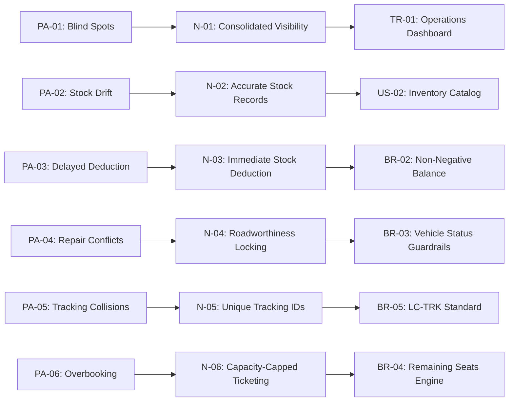

# LogiCraft: Needs Analysis & Requirements Derivation

**Document Reference**: `docs/03_needs.md`  
**Pain Area Source**: [docs/02_pain_areas.md](file:///C:/Users/KAIN/OneDrive/Desktop/logicraft/docs/02_pain_areas.md)  
**Stakeholder Source**: [docs/01_stakeholders.md](file:///C:/Users/KAIN/OneDrive/Desktop/logicraft/docs/01_stakeholders.md)  
**System Constraints**: Python Full-Stack (Django + SQLite) — [PA-01], [N-01]

---

## 1. Executive Summary

This document derives **6 user needs** directly from the shortlisted operational pain areas (**PA-01 to PA-06**). To maintain rigorous requirements engineering standards:
1. Each need is phrased in the canonical format: **"Who needs What so that Why"**.
2. Any preliminary statement that secretly smuggled in a **solution or technology** (e.g., specifying databases, GPS hardware, or frameworks) has been explicitly flagged, critiqued, and rewritten into a pure problem-space need.
3. **"How Might We" (HMW)** opportunity questions are formulated for the top 3 high-severity pain areas.

---

## 2. Needs Analysis Matrix (with Technology Trap Flags)

| Need ID | Pain ID | Target Stakeholder | Draft Statement & Solution/Tech Trap Flag | Refined Operational Need ("Who needs What so that Why") | Traceability |
| :---: | :---: | :--- | :--- | :--- | :---: |
| **N-01** | `PA-01` | Operations Director | 🚩 *Trap: "Needs a web dashboard using Django and Chart.js to replace emails."* *(Specifies frontend library and framework instead of operational objective).* | **The Operations Director needs** centralized, up-to-date visibility into multi-depot stock and fleet availability **so that** strategic dispatch decisions can be made without waiting for delayed daily email summaries. | `TR-01` `Dashboard` |
| **N-02** | `PA-02` | Warehouse Supervisor | 🚩 *Trap: "Needs RFID tags and handheld scanners in storage bays."* *(Specifies expensive physical hardware instead of data synchronization).* | **The Warehouse Supervisor needs** an accurate, per-location stock record that reflects physical shelf counts **so that** packing staff never receive pick lists for items that are not physically present in the storage bay. | `BR-02` `TC-06` |
| **N-03** | `PA-03` | Warehouse Supervisor | 🚩 *Trap: "Needs an automated SQL trigger or transactional database lock on order save."* *(Specifies database implementation details rather than business rule behavior).* | **The Warehouse Supervisor needs** immediate stock deduction at the moment an outbound order is confirmed **so that** the same inventory is never promised to multiple orders simultaneously. | `BR-02` `TC-02` |
| **N-04** | `PA-04` | Fleet Dispatcher | 🚩 *Trap: "Needs OBD-II telematics devices streaming vehicle health codes."* *(Specifies vehicle hardware sensors rather than operational state locking).* | **The Fleet Dispatcher needs** guaranteed visibility into whether a vehicle is currently roadworthy and available **so that** vehicles undergoing maintenance or repair are never assigned to time-critical deliveries. | `BR-03` `TC-03` |
| **N-05** | `PA-05` | Fleet Dispatcher | 🚩 *Trap: "Needs a UUID generation API service to generate tracking strings."* *(Specifies software implementation library instead of traceability standard).* | **The Fleet Dispatcher needs** standardized, non-duplicating tracking identifiers generated automatically upon dispatch **so that** cargo can be reliably searched and audited across all transit checkpoints. | `BR-05` `TC-04` |
| **N-06** | `PA-06` | Public Commuter | 🚩 *Trap: "Needs an online payment gateway and QR turnstile gates at bus stations."* *(Specifies financial third-party APIs and physical turnstile hardware).* | **The Public Commuter needs** advance seat availability checks and capacity-capped ticketing **so that** they are guaranteed a seat upon boarding without experiencing terminal overcrowding or rejection. | `BR-04` `TC-01` |

---

## 3. "How Might We..." (HMW) Opportunity Questions

Formulated for the **Top 3 High-Severity Pains** (**PA-01**, **PA-03**, **PA-06**):

### HMW-01 (Addressing PA-01: Multi-Depot Blind Spots)
> *"How might we provide executive management with an instant, consolidated operational overview across all regional depots without creating extra manual reporting overhead for depot staff?"*

### HMW-02 (Addressing PA-03: Double-Allocation of Inventory)
> *"How might we guarantee that inventory quantities remain perfectly synchronized across concurrent dispatches so that an item can never be promised more than once?"*

### HMW-03 (Addressing PA-06: Passenger Overbooking & Crowding)
> *"How might we prevent passenger overbooking at the point of booking so that commuters can travel with absolute confidence in seat availability?"*

---

## 4. Requirements Traceability Mapping

