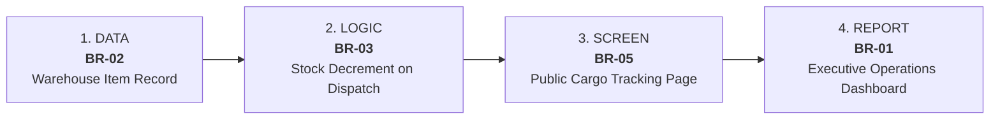

# LogiCraft: Traceability Matrix, MVP Scope & Prioritization

**Document Reference**: `docs/05_traceability.md`  
**Sources**: 
- [docs/02_pain_areas.md](file:///C:/Users/KAIN/OneDrive/Desktop/logicraft/docs/02_pain_areas.md) (Pain Areas)
- [docs/03_needs.md](file:///C:/Users/KAIN/OneDrive/Desktop/logicraft/docs/03_needs.md) (Needs Analysis)
- [docs/04_requirements.md](file:///C:/Users/KAIN/OneDrive/Desktop/logicraft/docs/04_requirements.md) (Requirements Specification)

---

## 1. Traceability Matrix (with Priority and Scope)

| PA ID | Pain (Observed Problem) | Stakeholder | Need ID | User Need ("Who needs What so that...") | BR ID | Business Requirement ("System shall...") | Priority | Scope |
| :---: | :--- | :--- | :---: | :--- | :---: | :--- | :---: | :---: |
| **PA-01** | Multi-depot operational blind spots | Operations Director | **N-01** | Centralized, up-to-date visibility into multi-depot stock and fleet availability without waiting for daily emails. | **BR-01** | Display aggregated count metrics for warehouses, available vehicles, and active shipments on dashboard. | **Must** | **MVP (Report)** |
| **PA-02** | Discrepancy between logged and physical stock | Warehouse Supervisor | **N-02** | Accurate per-location stock record reflecting physical shelf counts to prevent phantom picks. | **BR-02** | Require every inventory item record to be assigned to a registered warehouse. | **Must** | **MVP (Data)** |
| **PA-03** | Outbound shipments do not immediately decrement stock | Warehouse Supervisor | **N-03** | Immediate stock deduction at moment of order confirmation to prevent double-promising inventory. | **BR-03** | Decrement origin warehouse inventory stock by shipment quantity upon status update to Dispatched. | **Must** | **MVP (Logic)** |
| **PA-04** | Vehicles in repair mistakenly assigned to trips | Fleet Dispatcher | **N-04** | Guaranteed visibility into vehicle roadworthiness to prevent assigning maintenance vehicles. | **BR-04** | Prohibit assigning a vehicle to an active shipment when the vehicle status is Maintenance. | **Should** | **Final (Stretch)** |
| **PA-05** | Duplicate or manual tracking code lookup failures | Fleet Dispatcher | **N-05** | Standardized, auto-generated non-duplicating tracking identifiers for reliable parcel search. | **BR-05** | Generate unique tracking identifier matching format `LC-TRK-YYYYMMDD-XXXX` for every created shipment. | **Must** | **MVP (Screen)** |
| **PA-06** | Bus overbooking due to unconstrained ticketing | Public Commuter | **N-06** | Advance seat availability checks and capacity-capped ticketing to prevent boarding rejection. | **BR-06** | Reject ticket bookings for any transit schedule when confirmed bookings equal vehicle seat capacity. | **Could** | **Final (Stretch)** |

---

## 2. Standing Cross-Cutting Requirements

| SR ID | Category | Requirement ("System shall...") | Priority | Scope |
| :---: | :--- | :--- | :---: | :---: |
| **BR-07** | **Data Quality** | Prohibit negative numerical values for inventory stock quantities and vehicle capacities. | **Must** | **MVP (Foundational)** |
| **BR-08** | **Security & Privacy** | Restrict all pre-seeded user and passenger email records to synthetic `@example.com` domains. | **Must** | **MVP (Foundational)** |
| **BR-09** | **Reproducibility** | Provide complete isolated execution via pinned version boundaries in `requirements.txt`. | **Must** | **MVP (Foundational)** |

---

## 3. Approved MVP Definition (1 Working End-to-End Flow)

The approved MVP forms a single unbroken thread spanning **Data $\rightarrow$ Logic $\rightarrow$ Screen $\rightarrow$ Report**, achievable within ~10 build days:

1. **DATA LAYER [BR-02]**: Every inventory item is bound to a specific warehouse foreign key, creating dependable base inventory records.
2. **LOGIC LAYER [BR-03]**: Marking a shipment as `Dispatched` transactionally decrements warehouse stock and prevents negative stock balances.
3. **SCREEN LAYER [BR-05]**: Auto-generates a standardized `LC-TRK-YYYYMMDD-XXXX` tracking code and renders the public parcel tracking stepper and checkpoint timeline.
4. **REPORT LAYER [BR-01]**: Executive operations dashboard aggregates live counts across depots, available fleet, and active shipments.

### Justification for 10 Build Days
- **High Cohesion**: Focuses exclusively on the freight logistics backbone without splitting effort between cargo and public bus routing.
- **Pure Deterministic Code**: Uses native Django ORM queries and server-rendered templates, avoiding JavaScript framework build toolchains or third-party paid APIs.
- **Clear Verification**: Directly verified by automated tests `TC-02`, `TC-04`, `TC-06`, and Django system checks.

---

## 4. Final Release (Stretch) & Out-of-Scope Items

### Final Release (Stretch Scope)
* **BR-04 (Vehicle Maintenance Guardrail)**: Lockout logic prohibiting assignment of vehicles marked `MAINTENANCE`.
* **BR-06 (Public Transit Scheduling & Ticketing)**: Timetable search, seat availability counter, and passenger booking confirmations.

### Explicitly Out-of-Scope (Excluded from Project)
1. **Predictive Analytics**: No complex demand forecasting or dynamic surge pricing models (focus remains on core operational workflows).
2. **Physical IoT / Telematics Hardware**: No OBD-II sensors or streaming GPS hardware (checkpoints are software event logs).
3. **External Payment Gateways**: No real-money transaction processing (ticketing is simulated/direct confirmation).
4. **Multi-Tenant Enterprise RBAC**: No granular permissions beyond standard Django staff administration and anonymous public views.

---

## 5. Requirements Gap Analysis & Audit

* **Pains with No Need**: **None** (100% of `PA-01` to `PA-06` have corresponding `N-01` to `N-06`).
* **Needs with No Requirement**: **None** (100% of `N-01` to `N-06` have corresponding `BR-01` to `BR-06`).
* **Unlinked Requirements**: `BR-07`, `BR-08`, and `BR-09` trace directly to cross-cutting software engineering and privacy standards rather than specific end-user pains.
