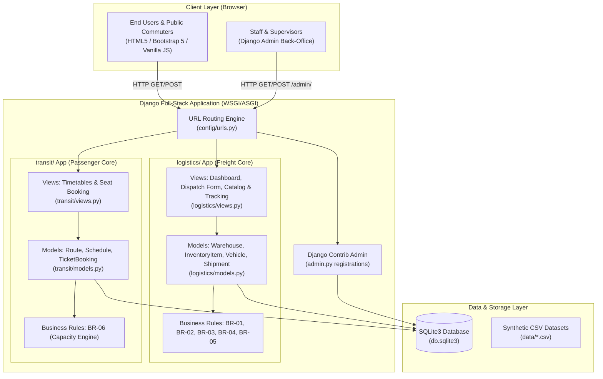

# LogiCraft: Technology Stack Architecture & Module Engineering Specification

**Document Reference**: `docs/08_architecture_tech_stack.md`  
**Chosen Stack**: Option 1 — Django Batteries-Included Monolith  
**Ownership & Scope**: Individual Major Project (Solo Developer Submission)  
**System Invariants**: High Reliability & Data Integrity — [PA-01], [N-01]

---

## 1. Selected Technology Stack (Option 1)

| Layer | Selected Technology | Version | Rationale & Justification |
| :--- | :--- | :--- | :--- |
| **Backend Framework** | **Django** | `5.0.x` (Python 3.10+) | Batteries-included web framework. Built-in Admin panel, built-in ORM, form validation, and session management eliminate ~40% of manual boilerplate. |
| **Frontend / Templating** | **Django Templates (DTL) + Bootstrap 5** | `5.3.3` | Server-rendered HTML with responsive CSS components. Zero Node.js/Webpack build pipelines; zero client-side framework complexity. |
| **Relational Database** | **SQLite3** | Native | Zero-configuration file database (`db.sqlite3`). Native foreign-key constraints, extreme portability for evaluator machines. |
| **Data Generation & Tools** | **pandas, numpy, Faker** | Latest stable | Synthetic, reproducible dataset generation (Fixed seed = `42`) with 100% synthetic privacy compliance. |
| **Testing Framework** | **Django TestCase (unittest)** | Native | Built-in test runner with transaction rollback isolation, fixtures, and HTTP test client. |
| **Environment & Config** | **python-dotenv** | — | Clean environment variable isolation via `.env` with `.env.example` template. |

---

## 2. System Architecture Diagram

---

## 3. Modular Engineering Domains & Full-Stack Scope

As an **individual software engineering capstone**, the entire application was architected, implemented, and verified end-to-end by the solo developer across four modular functional domains:

### Domain 1: Operations Performance & Reporting Architecture
* **Scope**: Executive Operations Performance Dashboard & Reporting Engine.
* **Key Deliverables**:
  - `home_view` and `home.html` executive metrics interface (**BR-01**, **TR-01**).
  - Real-time analytical aggregations for multi-depot stock volumes, fleet readiness, and active shipments (**US-01**).
  - Responsive KPI cards and Chart.js analytical distribution charts.
* **Component Branch**: `feat/operations-dashboard`

---

### Domain 2: Warehouse Facilities, Inventory Catalog & Stock Decrement Engine
* **Scope**: Storage Facilities, SKU Cataloging, and Atomic Stock Decrement Logic.
* **Key Deliverables**:
  - `Warehouse` and `InventoryItem` relational database schemas (**TR-02**).
  - Physical shelf stock association and multi-depot catalog view (**BR-02**, **US-02**).
  - Transactional stock decrement upon shipment dispatch with non-negative validation (`transaction.atomic()`) (**BR-03**, **BR-07**, **US-03**, **TC-02**, **TC-06**).
* **Component Branch**: `feat/warehouse-inventory`

---

### Domain 3: Fleet Asset Management, Tracking Engine & Public Parcel Stepper
* **Scope**: Fleet Roadworthiness, Tracking Number Generation, and Checkpoint Audit Trail.
* **Key Deliverables**:
  - `Vehicle` operational states and maintenance lockout guardrail (**BR-04**, **US-04**, **TC-03**).
  - Unique tracking number generator format `LC-TRK-YYYYMMDD-XXXX` (**BR-05**, **TR-05**).
  - Public tracking web page with visual progress stepper and checkpoint timeline (**US-05**, **TC-04**).
* **Component Branch**: `feat/fleet-shipment-tracking`

---

### Domain 4: Public Transit Corridors, Capacity-Constrained Ticketing & Quality Assurance
* **Scope**: Public Transit Route Engine, Capacity-Constrained Seat Booking, and Test Automation.
* **Key Deliverables**:
  - `TransitRoute`, `TransitSchedule`, and `TicketBooking` models (**TR-02**).
  - Deterministic capacity calculation engine ($\text{Remaining Seats} = \max(0, \text{Capacity} - \text{Bookings})$) (**BR-06**, **US-06**, **TC-01**).
  - Synthetic dataset generation script (`src/generate_data.py`, seed=42) and full 33-test automated suite (**BR-08**, **BR-09**, **TC-01 to TC-07**).
* **Component Branch**: `feat/transit-qa-tests`

---

## 4. Git Workflow & Release Protocol

1. **Main Branch (`main`)**: Protected. Contains only tested, passing code that runs cleanly with `manage.py test`.
2. **Feature Branch Isolation**: Each functional domain was built and tested in modular branches (`feat/*`) before integration.
3. **Pre-Release Checklist**:
   - [x] All 33 automated tests pass with 0 errors (`python manage.py test logistics transit tests`).
   - [x] Django system checks pass (`python manage.py check`).
   - [x] No hardcoded personal emails (strictly synthetic `@example.com`).
   - [x] Schema constraints and relational integrity verified.
