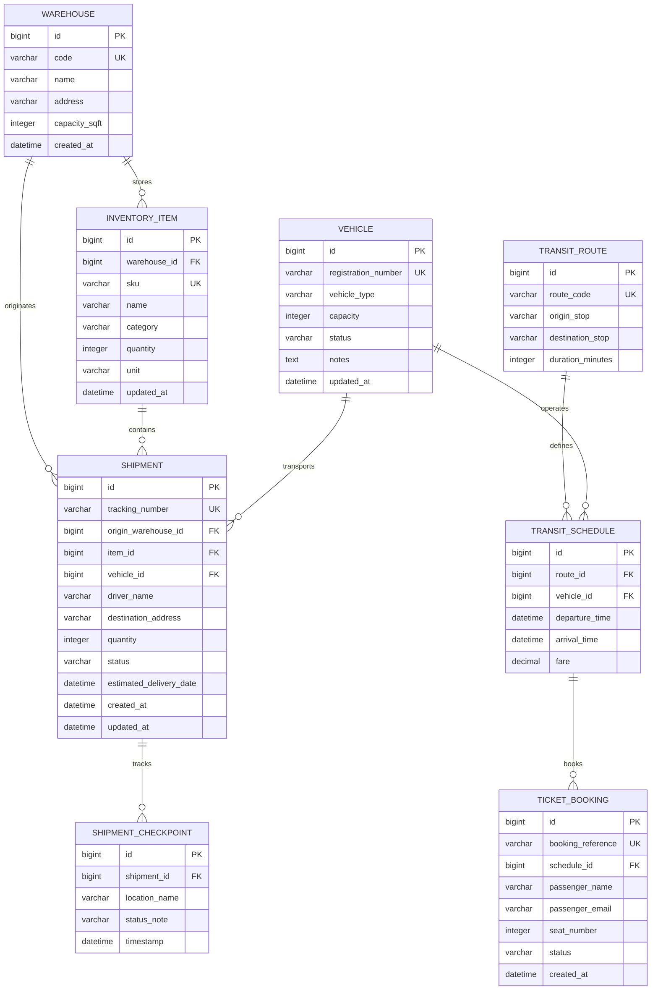

# LogiCraft: Dataset Architecture & Design Specification

**Document Reference**: `docs/09_data_design.md`  
**Requirements & Tests**: [docs/04_requirements.md](file:///C:/Users/KAIN/OneDrive/Desktop/logicraft/docs/04_requirements.md) | [docs/07_test_cases.md](file:///C:/Users/KAIN/OneDrive/Desktop/logicraft/docs/07_test_cases.md)  
**Data Ethics**: 100% Synthetic Data Only (No PII) — [BR-08], [TR-08]

---

## 1. Executive Summary

This document specifies the synthetic dataset architecture for LogiCraft.
The design supports all **MVP requirements** (**BR-01, BR-02, BR-03, BR-05**), **Stretch features** (**BR-04, BR-06**), and **automated test cases** (**TC-01 to TC-07**). 
It details:
1. Relational tables with Primary Keys (PK) and Foreign Keys (FK).
2. Entity-Relationship (ER) diagram in standard Mermaid syntax.
3. Realistic distribution patterns (depot volume skew, transit rush-hour peaks, fleet availability ratios).
4. Deliberately engineered edge cases (zero inventory, sold-out buses, maintenance vehicles, unassigned shipments) to ensure every automated and manual test case has seed data to execute against.

---

## 2. Entity-Relationship (ER) Diagram

---

## 3. Relational Table Specifications & Data Dictionary

The LogiCraft database contains **8 relational tables** partitioned across two modular applications (`logistics` and `transit`). All schemas enforce deterministic relational integrity using SQLite with standard Foreign Key constraints.

### 3.1. Table: `logistics_warehouse` (`Warehouse`)
Stores regional physical storage facilities and logistics depots.

| Column Name | SQL Data Type | Django Field Type | Constraints | Default | Description | Business Rule |
| :--- | :--- | :--- | :--- | :--- | :--- | :--- |
| `id` | `INTEGER` | `BigAutoField` | **PK**, Auto Increment | Auto | Unique internal warehouse identifier | — |
| `code` | `VARCHAR(20)` | `CharField(max_length=20)` | **UK**, NOT NULL | None | Alphanumeric depot identifier (e.g., `WH-DEL-01`) | **BR-02** |
| `name` | `VARCHAR(100)` | `CharField(max_length=100)` | NOT NULL | None | Descriptive name of the regional depot | — |
| `address` | `VARCHAR(255)` | `CharField(max_length=255)` | NOT NULL | None | Street and city address location | — |
| `capacity_sqft` | `INTEGER` | `PositiveIntegerField` | NOT NULL, $\ge 0$ | None | Storage floor space capacity in square feet | **BR-07** |
| `created_at` | `DATETIME` | `DateTimeField` | NOT NULL | `auto_now_add` | Timestamp when warehouse record was registered | — |

---

### 3.2. Table: `logistics_inventoryitem` (`InventoryItem`)
Catalogs physical stock items held inside a specific warehouse facility.

| Column Name | SQL Data Type | Django Field Type | Constraints | Default | Description | Business Rule |
| :--- | :--- | :--- | :--- | :--- | :--- | :--- |
| `id` | `INTEGER` | `BigAutoField` | **PK**, Auto Increment | Auto | Unique internal item identifier | — |
| `warehouse_id` | `INTEGER` | `ForeignKey(Warehouse)` | **FK**, NOT NULL, `ON DELETE CASCADE` | None | Warehouse where this stock is physically located | **BR-02** |
| `sku` | `VARCHAR(50)` | `CharField(max_length=50)` | **UK**, NOT NULL | None | Stock Keeping Unit code (e.g., `SKU-SOL-101`) | **BR-02** |
| `name` | `VARCHAR(100)` | `CharField(max_length=100)` | NOT NULL | None | Product name description | — |
| `category` | `VARCHAR(50)` | `CharField(max_length=50)` | NOT NULL | None | Functional category (e.g., `Renewable Energy`) | — |
| `quantity` | `INTEGER` | `PositiveIntegerField` | NOT NULL, $\ge 0$ | `0` | Available units on hand; decremented on dispatch | **BR-02, BR-03, BR-07** |
| `unit` | `VARCHAR(20)` | `CharField(max_length=20)` | NOT NULL | `'units'` | Measurement unit (e.g., `boxes`, `pallets`) | — |
| `updated_at` | `DATETIME` | `DateTimeField` | NOT NULL | `auto_now` | Timestamp of last stock update or restock | — |

---

### 3.3. Table: `logistics_vehicle` (`Vehicle`)
Maintains operational fleet assets used for cargo transport or passenger bus routes.

| Column Name | SQL Data Type | Django Field Type | Constraints | Default | Description | Business Rule |
| :--- | :--- | :--- | :--- | :--- | :--- | :--- |
| `id` | `INTEGER` | `BigAutoField` | **PK**, Auto Increment | Auto | Unique internal vehicle identifier | — |
| `registration_number` | `VARCHAR(20)` | `CharField(max_length=20)` | **UK**, NOT NULL | None | Vehicle license plate number (e.g., `DL-01-TR-9021`) | — |
| `vehicle_type` | `VARCHAR(10)` | `CharField(max_length=10)` | NOT NULL, Choices | `'TRUCK'` | Type: `TRUCK` (Cargo), `VAN` (Delivery), `BUS` (Transit) | — |
| `capacity` | `INTEGER` | `PositiveIntegerField` | NOT NULL, $\ge 0$ | None | Payload payload (kg) or maximum passenger seats | **BR-04, BR-07** |
| `status` | `VARCHAR(15)` | `CharField(max_length=15)` | NOT NULL, Choices | `'AVAILABLE'` | Status: `AVAILABLE`, `IN_TRANSIT`, `MAINTENANCE` | **BR-04** |
| `notes` | `TEXT` | `TextField` | NULLABLE | `""` | Maintenance logs or vehicle condition comments | — |
| `updated_at` | `DATETIME` | `DateTimeField` | NOT NULL | `auto_now` | Timestamp of last status change | — |

---

### 3.4. Table: `logistics_shipment` (`Shipment`)
Manages cargo shipments moving from a source warehouse to a destination.

| Column Name | SQL Data Type | Django Field Type | Constraints | Default | Description | Business Rule |
| :--- | :--- | :--- | :--- | :--- | :--- | :--- |
| `id` | `INTEGER` | `BigAutoField` | **PK**, Auto Increment | Auto | Unique internal shipment record identifier | — |
| `tracking_number` | `VARCHAR(32)` | `CharField(max_length=32)` | **UK**, NOT NULL | Auto function | Deterministic code (`LC-TRK-YYYYMMDD-XXXX`) | **BR-05** |
| `origin_warehouse_id`| `INTEGER` | `ForeignKey(Warehouse)` | **FK**, NOT NULL, `ON DELETE PROTECT` | None | Origin dispatch depot | **BR-01, BR-02** |
| `item_id` | `INTEGER` | `ForeignKey(InventoryItem)` | **FK**, NOT NULL, `ON DELETE PROTECT` | None | Item being shipped (must match origin warehouse) | **BR-02, BR-03** |
| `quantity` | `INTEGER` | `PositiveIntegerField` | NOT NULL, $> 0$ | `1` | Quantity units dispatched | **BR-03** |
| `destination_address`| `VARCHAR(255)` | `CharField(max_length=255)` | NOT NULL | None | Delivery destination address | — |
| `vehicle_id` | `INTEGER` | `ForeignKey(Vehicle)` | **FK**, NULLABLE, `ON DELETE SET_NULL`| `None` | Vehicle assigned to transport cargo | **BR-04** |
| `driver_name` | `VARCHAR(100)` | `CharField(max_length=100)` | NULLABLE | `""` | Name of assigned freight driver | **BR-04** |
| `status` | `VARCHAR(15)` | `CharField(max_length=15)` | NOT NULL, Choices | `'PENDING'` | `PENDING`, `DISPATCHED`, `IN_TRANSIT`, `DELIVERED`, `CANCELLED` | **BR-01, BR-03** |
| `estimated_delivery_date` | `DATETIME` | `DateTimeField` | NULLABLE | `None` | Estimated arrival date/time at destination | **BR-05** |
| `created_at` | `DATETIME` | `DateTimeField` | NOT NULL | `auto_now_add` | Timestamp when shipment order was created | — |
| `updated_at` | `DATETIME` | `DateTimeField` | NOT NULL | `auto_now` | Timestamp of last status modification | — |

---

### 3.5. Table: `logistics_shipmentcheckpoint` (`ShipmentCheckpoint`)
Maintains an immutable chronological audit trail of shipment movement waypoints.

| Column Name | SQL Data Type | Django Field Type | Constraints | Default | Description | Business Rule |
| :--- | :--- | :--- | :--- | :--- | :--- | :--- |
| `id` | `INTEGER` | `BigAutoField` | **PK**, Auto Increment | Auto | Unique checkpoint log identifier | — |
| `shipment_id` | `INTEGER` | `ForeignKey(Shipment)` | **FK**, NOT NULL, `ON DELETE CASCADE` | None | Associated shipment record | **BR-05** |
| `location_name` | `VARCHAR(120)` | `CharField(max_length=120)` | NOT NULL | None | Name of waypoint (e.g., `Yamuna Expressway Toll`) | — |
| `status_note` | `VARCHAR(255)` | `CharField(max_length=255)` | NOT NULL | None | Progress comment (e.g., `Cargo cleared toll hub`) | — |
| `timestamp` | `DATETIME` | `DateTimeField` | NOT NULL | `timezone.now` | Date and time waypoint was logged | **BR-05** |

---

### 3.6. Table: `transit_transitroute` (`TransitRoute`)
Defines fixed public transit lines between major terminals.

| Column Name | SQL Data Type | Django Field Type | Constraints | Default | Description | Business Rule |
| :--- | :--- | :--- | :--- | :--- | :--- | :--- |
| `id` | `INTEGER` | `BigAutoField` | **PK**, Auto Increment | Auto | Unique route identifier | — |
| `route_code` | `VARCHAR(20)` | `CharField(max_length=20)` | **UK**, NOT NULL | None | Route code identifier (e.g., `ROUTE-101`) | — |
| `origin_stop` | `VARCHAR(100)` | `CharField(max_length=100)` | NOT NULL | None | Origin boarding terminal | — |
| `destination_stop` | `VARCHAR(100)` | `CharField(max_length=100)` | NOT NULL | None | Final destination terminal | — |
| `duration_minutes` | `INTEGER` | `PositiveIntegerField` | NOT NULL, $> 0$ | None | Estimated one-way trip duration | — |

---

### 3.7. Table: `transit_transitschedule` (`TransitSchedule`)
Schedules departure times for a specific transit route assigned to a passenger bus.

| Column Name | SQL Data Type | Django Field Type | Constraints | Default | Description | Business Rule |
| :--- | :--- | :--- | :--- | :--- | :--- | :--- |
| `id` | `INTEGER` | `BigAutoField` | **PK**, Auto Increment | Auto | Unique schedule instance identifier | — |
| `route_id` | `INTEGER` | `ForeignKey(TransitRoute)` | **FK**, NOT NULL, `ON DELETE CASCADE` | None | Route being serviced | — |
| `vehicle_id` | `INTEGER` | `ForeignKey(Vehicle)` | **FK**, NOT NULL, `vehicle_type='BUS'` | None | Passenger bus assigned to this run | **BR-06** |
| `departure_time` | `DATETIME` | `DateTimeField` | NOT NULL | None | Scheduled departure timestamp | — |
| `arrival_time` | `DATETIME` | `DateTimeField` | NOT NULL, `> departure_time` | None | Scheduled arrival timestamp | — |
| `fare` | `DECIMAL(7,2)`| `DecimalField(max_digits=7)`| NOT NULL, $\ge 0$ | `50.00` | Passenger ticket price (INR) | — |

---

### 3.8. Table: `transit_ticketbooking` (`TicketBooking`)
Stores passenger seat reservations validated against bus capacity.

| Column Name | SQL Data Type | Django Field Type | Constraints | Default | Description | Business Rule |
| :--- | :--- | :--- | :--- | :--- | :--- | :--- |
| `id` | `INTEGER` | `BigAutoField` | **PK**, Auto Increment | Auto | Unique ticket booking identifier | — |
| `booking_reference`| `VARCHAR(32)` | `CharField(max_length=32)` | **UK**, NOT NULL | Auto function | Unique reservation reference (`LC-TKT-XXXXXX`) | — |
| `schedule_id` | `INTEGER` | `ForeignKey(TransitSchedule)`| **FK**, NOT NULL, `ON DELETE CASCADE` | None | Schedule trip reserved | **BR-06** |
| `passenger_name` | `VARCHAR(100)` | `CharField(max_length=100)` | NOT NULL | None | Synthetic passenger full name | **BR-08** |
| `passenger_email` | `VARCHAR(254)` | `EmailField` | NOT NULL | None | Synthetic passenger email (`@example.com`) | **BR-08** |
| `seat_number` | `INTEGER` | `PositiveIntegerField` | NOT NULL, $\le \text{Capacity}$ | None | Specific seat number allocated | **BR-06** |
| `status` | `VARCHAR(12)` | `CharField(max_length=12)` | NOT NULL, Choices | `'CONFIRMED'`| Booking status (`CONFIRMED`, `CANCELLED`) | **BR-06** |
| `created_at` | `DATETIME` | `DateTimeField` | NOT NULL | `auto_now_add` | Timestamp when ticket was booked | — |

---

## 4. Target Dataset Row Counts (Evaluation Volume)

To ensure realistic dashboard aggregations and test coverage without unnecessary local disk footprint:

| Table Entity | Target Row Count | Purpose & Domain Coverage |
| :--- | :---: | :--- |
| **Warehouse** | **5 – 8** | Regional hub depots (North, West, South, East, Central). |
| **InventoryItem** | **50 – 80** | Multi-category catalog (Electronics, Medical, Solar, Industrial). |
| **Vehicle** | **20 – 30** | Multi-type fleet (12 Trucks, 10 Delivery Vans, 8 Transit Buses). |
| **Shipment** | **40 – 60** | Parcel lifecycle states (10 Delivered, 15 In Transit, 10 Dispatched, 5 Pending). |
| **ShipmentCheckpoint** | **120 – 180** | Chronological audit trail (2 to 5 waypoints per active/delivered shipment). |
| **TransitRoute** | **6 – 10** | High-demand municipal and airport transit corridors. |
| **TransitSchedule** | **20 – 30** | Scheduled morning, afternoon, and evening departures. |
| **TicketBooking** | **100 – 150** | Synthetic bookings ensuring varied remaining seat counts. |

---

## 5. Realistic Distribution Patterns & Business Rules

1. **Warehouse Depot Volume Skew (80/20 Rule)**:
   * **Tier 1 Primary Hubs** (e.g., Delhi `WH-DEL-01`, Mumbai `WH-MUM-01`): Store **65%** of all catalog items and process **70%** of outbound shipments.
   * **Tier 2 Regional Spokes** (e.g., Bengaluru `WH-BLR-01`, Kolkata `WH-KOL-01`): Store **35%** of inventory items with smaller buffer stocks.
2. **Fleet Operational Status Distribution**:
   * **Available (`AVAILABLE`)**: ~**70%** of the fleet (ready for immediate dispatch).
   * **In Transit (`IN_TRANSIT`)**: ~**20%** of the fleet (currently assigned to active runs).
   * **Under Maintenance (`MAINTENANCE`)**: ~**10%** of the fleet (workshop repairs / safety inspections).
3. **Public Transit Departure Clustering**:
   * **Morning Peak (07:30 – 09:30)**: Clustered commuter runs on municipal express routes.
   * **Evening Peak (17:00 – 19:30)**: Clustered return runs with heavy passenger seat bookings.
   * **Midday Off-Peak (11:00 – 15:00)**: Reduced frequency with lower booking density.
4. **Shipment Lifecycle State Proportions**:
   * `DELIVERED`: ~40% (Historical completed orders).
   * `IN_TRANSIT`: ~30% (Actively moving through checkpoints).
   * `DISPATCHED`: ~15% (Departed warehouse, awaiting first waypoint).
   * `PENDING`: ~10% (Created, awaiting driver/vehicle assignment).
   * `CANCELLED`: ~5% (Cancelled prior to dispatch).

---

## 6. Deliberately Engineered Test Edge Cases

Every automated and manual test case from [docs/07_test_cases.md](file:///C:/Users/KAIN/OneDrive/Desktop/logicraft/docs/07_test_cases.md) has specifically seeded records to trigger its logic:

| Edge Case Name | Entity | Seeded Data Condition | Targeted Test Case |
| :--- | :--- | :--- | :---: |
| **Zero-Stock Out-of-Stock Item** | `InventoryItem` | `quantity = 0`, SKU `SKU-ZERO-999` | **TC-03.2** (Rejects dispatch when requested > stock) |
| **Low-Stock Boundary Item** | `InventoryItem` | `quantity = 3`, SKU `SKU-LOW-003` | **TC-03.1** / **TC-03.2** (Tests exact boundary stock deduction) |
| **Locked Maintenance Vehicle** | `Vehicle` | `status = 'MAINTENANCE'`, `registration = 'DL-01-TR-3399'` | **TC-04.2** (Rejects assignment of servicing vehicle) |
| **Sold-Out Bus Schedule** | `TransitSchedule` | `vehicle.capacity = 25`, `confirmed_bookings = 25` | **TC-06.2** (Rejects booking when remaining seats = 0) |
| **Single-Seat-Left Schedule** | `TransitSchedule` | `vehicle.capacity = 30`, `confirmed_bookings = 29` | **TC-06.1** (Tests transition from available to sold out) |
| **Unassigned Vehicle Shipment** | `Shipment` | `vehicle = null`, `status = 'PENDING'` | **TC-01.1** (Verifies dashboard handles unassigned cargo) |
| **Zero Checkpoint Shipment** | `Shipment` | Has 0 linked `ShipmentCheckpoint` rows | **TC-05.1** (Verifies UI renders gracefully without waypoints) |
| **Special Character Address** | `Shipment` | `destination = 'Plot #42/B, Industrial Sector-62, Noida (U.P.) - 201309'` | Data Quality (Tests address sanitization and rendering) |

---

## 7. Synthetic Privacy Guardrail Standards

1. **Synthetic Passenger Names**: Drawn from common test naming pools (e.g. `Aarav Mehta`, `Pooja Verma`, `Rohan Sharma`, `Neha Gupta`).
2. **Email Addresses**: 100% constrained to the reserved RFC 2606 domain (`@example.com`). Real personal domains (`@gmail.com`, `@yahoo.com`) are strictly prohibited in all seed files.
3. **Phone Numbers & Identification**: Zero actual tax IDs, phone numbers, or credit card numbers are stored.
