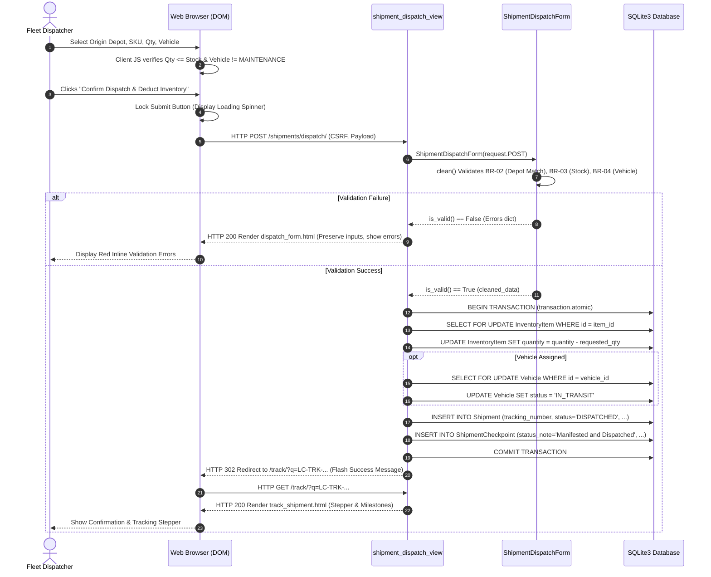
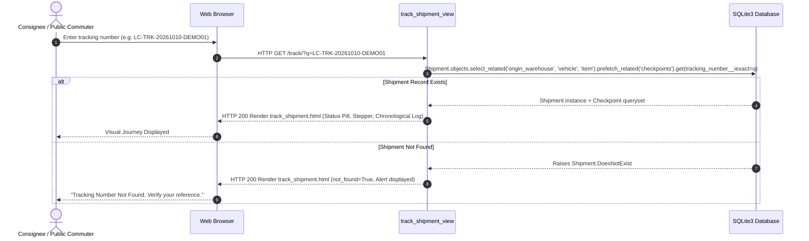
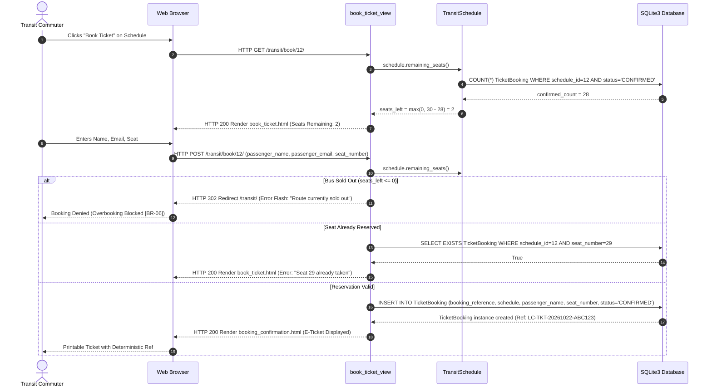

# LogiCraft: Backend Integration & Interface-to-Operations Specification

**Document Reference**: `docs/10_backend_integration.md`  
**Related Documents**:
* Requirements & Invariants: [docs/04_requirements.md](file:///C:/Users/KAIN/OneDrive/Desktop/logicraft/docs/04_requirements.md)
* Traceability Matrix: [docs/05_traceability.md](file:///C:/Users/KAIN/OneDrive/Desktop/logicraft/docs/05_traceability.md)
* User Stories Catalog: [docs/06_user_stories.md](file:///C:/Users/KAIN/OneDrive/Desktop/logicraft/docs/06_user_stories.md)
* Test Verification Matrix: [docs/07_test_cases.md](file:///C:/Users/KAIN/OneDrive/Desktop/logicraft/docs/07_test_cases.md)
* Relational Data Design: [docs/09_data_design.md](file:///C:/Users/KAIN/OneDrive/Desktop/logicraft/docs/09_data_design.md)
* Interactive Wireframe: [docs/wireframe.html](file:///C:/Users/KAIN/OneDrive/Desktop/logicraft/docs/wireframe.html)

---

## 1. Executive Summary & Architecture Context

This document provides the formal **Interface-to-Backend Operations Mapping** for **LogiCraft (Logistics & Fleet Management)**. It connects every user action, visual control, and form submission from the frontend templates to its concrete Django MVT backend implementation, database transaction, and response contract.

### Architectural Invariants Enforced
1. **Deterministic Logic & Reliability**: All routing, seat calculations, and dispatch decisions are powered by explicit relational and transactional constraints.
2. **Deterministic Transactional Boundaries (`TR-02`)**: Operations altering multi-record state (e.g., manifest creation + stock deduction + vehicle state change + checkpoint creation) execute inside an atomic transaction (`with transaction.atomic():`). Any failure rolls back state completely.
3. **Form Re-Entry & State Preservation**: Failed submissions never clear user inputs. Form values are re-rendered with field-specific validation errors and Bootstrap invalid state styling.
4. **Anti-Duplicate Submission Lock**: Frontend event listeners disable submit controls and display spinner feedback to prevent duplicate transactions on network latency.
5. **Synthetic Privacy Compliance (`BR-08`)**: All customer and commuter communications strictly utilize reserved `@example.com` domains.

---

## 2. Master Interface-to-Backend Operations Mapping Table

| Screen ID | Page Name & Route | User Role | User Action / Trigger | Required Data Payload | Backend View & Endpoint | HTTP Method | Database ORM Query & Business Invariant | Expected Response & HTTP Status |
| :---: | :--- | :--- | :--- | :--- | :--- | :---: | :--- | :--- |
| **SCR-01A** | Staff Sign-In<br>`/accounts/login/` | Any Staff Member | Submit login credentials | `username`<br>`password`<br>`next` (optional redirect) | `logistics.views.login_view`<br>`name='login'` | `POST` | `authenticate(username, password)`.<br>Verifies password hash against `auth_user`. | **Success**: HTTP 302 Redirect to `/` or `next` URL with welcome flash message.<br>**Failure**: HTTP 200 re-renders form with username preserved and red error alert. |
| **SCR-01B** | Staff Registration<br>`/accounts/register/` | New Staff Member | Register new operator account | `username`<br>`email`<br>`role` (`DIRECTOR`, `SUPERVISOR`, `DISPATCHER`)<br>`password`<br>`confirm_password` | `logistics.views.register_view`<br>`name='register'` | `POST` | Validates password matching, min 6 chars, and username uniqueness.<br>Creates `User` via `create_user()`.<br>Sets `is_staff=True` for operational roles. | **Success**: HTTP 302 Redirect to `/` with auto-login and session cookie.<br>**Failure**: HTTP 200 re-renders form with context preserved and error messages. |
| **SCR-01C** | Staff Sign-Out<br>`/accounts/logout/` | Authenticated Staff | Click "Sign Out" button in navbar | Session cookie / CSRF | `logistics.views.logout_view`<br>`name='logout'` | `GET` / `POST` | Calls `django.contrib.auth.logout(request)`.<br>Flushes active session from `django_session` table. | HTTP 302 Redirect to `/` with informational flash message. |
| **SCR-02** | Operations Dashboard<br>`/` or `/dashboard/` | Operations Director (`US-01`) | Page load / refresh | None (Read-only view) | `logistics.views.home_view`<br>`name='home'` | `GET` | **`BR-01`, `TR-01`**: Computes `.count()` and `.aggregate(Sum('quantity'))` across `Warehouse`, `InventoryItem`, `Vehicle`, `Shipment`, and `TicketBooking`. Annotates depot stock for Chart.js. | HTTP 200 renders `home.html` with KPI metric counters, 3 Chart.js graphs, critical alert cards, and recent shipments feed. |
| **SCR-03** | Inventory Catalog<br>`/inventory/` or Admin | Warehouse Supervisor (`US-02`) | Filter inventory by depot or search SKU | `warehouse_id` (optional)<br>`search` (optional) | `logistics.views.inventory_list_view`<br>(or Django Admin `/admin/logistics/inventoryitem/`) | `GET` | **`BR-02`, `TR-02`**: Enforces foreign key constraint on `InventoryItem.warehouse`. Queries `InventoryItem.objects.select_related('warehouse')`. | HTTP 200 displays tabular stock list with on-hand quantity, category, and storage depot. |
| **SCR-04A** | Shipment Dispatch Form<br>`/shipments/dispatch/` | Fleet Dispatcher (`US-03`, `US-04`) | Open dispatch creation form | None (Loads form & catalog) | `logistics.views.shipment_dispatch_view`<br>`name='shipment_dispatch'` | `GET` | Fetches `Warehouse.objects.all()`, `InventoryItem.objects.all()`, and `Vehicle.objects.all()`. Builds JSON metadata for dynamic client stock meters. | HTTP 200 renders `dispatch_form.html` with grouped form cards, live stock meter pill, and recent verification log table. |
| **SCR-04B** | Confirm Shipment Dispatch<br>`/shipments/dispatch/` | Fleet Dispatcher (`US-03`, `US-04`) | Click "Confirm Dispatch & Deduct Inventory" | `origin_warehouse`<br>`destination_address`<br>`item`<br>`quantity`<br>`vehicle`<br>`driver_name`<br>`status`<br>`estimated_delivery_date` | `logistics.views.shipment_dispatch_view`<br>`name='shipment_dispatch'` | `POST` | **`BR-02`**: Origin warehouse must match `item.warehouse`.<br>**`BR-03`, `TR-03`**: Rejects if `quantity > item.quantity`.<br>**`BR-04`, `TR-04`**: Rejects if `vehicle.status == MAINTENANCE`.<br>**`TR-02`**: Inside `transaction.atomic()`, decrements `item.quantity`, sets `vehicle.status = IN_TRANSIT`, saves `Shipment`, and creates initial `ShipmentCheckpoint`. | **Success**: HTTP 302 Redirect to `/track/?q=<tracking_number>` with success flash message.<br>**Failure**: HTTP 200 re-renders form with preserved input values and inline error alerts. |
| **SCR-05A** | Public Tracking Search<br>`/track/` | Consignee / Public (`US-05`) | Enter tracking number and click Track | `q` (Query parameter, e.g. `LC-TRK-20261010-DEMO01`) | `logistics.views.track_shipment_view`<br>`name='track_shipment'` | `GET` | **`BR-05`, `TR-05`**: Case-insensitive exact match: `Shipment.objects.prefetch_related('checkpoints').get(tracking_number__iexact=q)`. | **Found**: HTTP 200 renders `track_shipment.html` with current status badge, milestone stepper, and chronological checkpoint audit trail.<br>**Not Found**: HTTP 200 renders "Tracking Number Not Found" alert with search bar preserved. |
| **SCR-05B** | Record Transit Checkpoint<br>`/track/checkpoint/` | Field Staff / Driver | Append waypoint milestone | `shipment_id`<br>`location_name`<br>`status_note` | `logistics.views.add_checkpoint_view`<br>(or Django Admin `/admin/logistics/shipmentcheckpoint/add/`) | `POST` | Validates active shipment; inserts `ShipmentCheckpoint(shipment, location_name, status_note, timestamp=now)`. Updates `Shipment.updated_at`. | HTTP 302 Redirect back to `/track/?q=<tracking_number>` with updated milestone stepper. |
| **SCR-06** | Fleet Maintenance Management<br>`/admin/logistics/vehicle/` | Fleet Dispatcher (`US-04`) | Toggle vehicle status between `AVAILABLE` and `MAINTENANCE` | `vehicle_id`<br>`status`<br>`notes` | Django Admin View<br>`/admin/logistics/vehicle/<id>/change/` | `POST` | Validates vehicle record; updates `status` field. If changed to `MAINTENANCE`, vehicle is instantly excluded from active dispatch eligibility (`BR-04`). | HTTP 302 Redirect to fleet list with confirmation banner. |
| **SCR-07A** | Transit Timetable Search<br>`/transit/` | Public Commuter (`US-06`) | Search routes by origin / destination stop | `origin` (optional)<br>`destination` (optional) | `transit.views.transit_schedules_view`<br>`name='transit_schedules'` | `GET` | **`BR-06`, `TR-06`**: Queries `TransitSchedule.objects.select_related('route', 'vehicle')`. Dynamically computes `seats_left = max(0, vehicle.capacity - confirmed_bookings)` per schedule. | HTTP 200 renders `schedule_list.html` with route codes, departure times, fares, remaining seats badges, and "Book Ticket" buttons (disabled if 0 seats left). |
| **SCR-07B** | Book Transit Ticket<br>`/transit/book/<id>/` | Public Commuter (`US-06`) | Submit passenger name, email, and seat number | `schedule_id` (URL param)<br>`passenger_name`<br>`passenger_email`<br>`seat_number` | `transit.views.book_ticket_view`<br>`name='book_ticket'` | `POST` | **`BR-06`, `TR-06`**: Rejects if `remaining_seats() <= 0` (sold-out guard).<br>Validates `1 <= seat_number <= capacity`.<br>Rejects duplicate seat reservation.<br>Creates `TicketBooking` with status `CONFIRMED`. | **Success**: HTTP 200 renders `booking_confirmation.html` displaying booking reference `LC-TKT-YYYYMMDD-XXXX`.<br>**Failure**: HTTP 200 re-renders form with error alert (e.g., "Seat already reserved"). |

---

## 3. Data Flow & Transaction Sequence Diagrams

### 3.1 Sequence 1: Outbound Shipment Dispatch & Stock Decrement (`SCR-04`)
This sequence demonstrates the full atomic execution cycle of business rules `BR-02`, `BR-03`, and `BR-04`.



---

### 3.2 Sequence 2: Public Cargo Tracking Query (`SCR-05`)
This sequence illustrates parcel lookups by anonymous customers or staff members.



---

### 3.3 Sequence 3: Commuter Seat Booking with Capacity Gate (`SCR-07`)
This sequence demonstrates deterministic overbooking prevention (`BR-06`).



---

## 4. Error Handling, State Preservation & Failure Recovery

### 4.1 Client-Side Validation & Duplicate Prevention
To guarantee high usability and data integrity:
1. **Submit Lockout**: When the user clicks the submit button on forms (`login`, `register`, `dispatch_form`, `book_ticket`), JavaScript immediately sets `submitBtn.disabled = true` and updates the label with a Bootstrap spinner (`<span class="spinner-border spinner-border-sm me-2"></span> Processing...`).
2. **Preventing Erroneous Requests**: The client checks that quantity $\le$ available stock and that vehicle status $\neq$ `MAINTENANCE` before sending the HTTP request, reducing unnecessary network round-trips.

### 4.2 Server-Side State Preservation
When a request fails server validation:
1. **Preserving Inputs**: The view passes the bound form instance back to the template. Django's form rendering engine automatically populates existing inputs with the values the user typed.
2. **Field-Specific Errors**: Errors are bound directly to the offending field (e.g. `form.quantity.errors`), allowing Bootstrap's `.is-invalid` and `<div class="text-danger small">` to render directly under the corresponding input.
3. **Non-Field Errors**: Cross-cutting errors (e.g. invalid username/password combination) render in a prominent Bootstrap dismissible alert banner at the top of the card.

### 4.3 Database Transaction Rollback Guarantees
In [`shipment_dispatch_view`](file:///C:/Users/KAIN/OneDrive/Desktop/logicraft/logistics/views.py#L226-L318):
```python
with transaction.atomic():
    # 1. Deduct Inventory
    item.quantity -= shipment.quantity
    item.save(update_fields=['quantity', 'updated_at'])
    
    # 2. Lock Vehicle
    vehicle.status = Vehicle.STATUS_IN_TRANSIT
    vehicle.save(update_fields=['status', 'updated_at'])
    
    # 3. Create Shipment
    shipment.save()
    
    # 4. Create Audit Checkpoint
    ShipmentCheckpoint.objects.create(...)
```
If any database error, validation exception, or server failure occurs between steps 1 and 4:
* SQLite issues a complete `ROLLBACK TRANSACTION`.
* The inventory quantity does not decrease.
* The vehicle status does not change.
* No orphan shipment or checkpoint is persisted.
* An error response is returned to the user with zero data corruption.

---

## 5. View Signatures & Request-Response Contracts

### View 1: `home_view(request)`
* **File**: `logistics/views.py`
* **Route**: `/` and `/dashboard/`
* **HTTP Method**: `GET`
* **Authentication**: Public or Staff
* **Context Contract**:
  * `stats`: Dictionary containing integer counts for `total_warehouses`, `total_inventory_skus`, `total_inventory_units`, `vehicles_available`, `vehicles_in_transit`, `vehicles_maintenance`, `vehicles_total`, `shipments_total`, `shipments_active`, `shipments_delivered`, `transit_routes`, `transit_schedules`, `transit_bookings`.
  * `chart_wh_labels`, `chart_wh_units`: JSON-encoded lists for Depot Stock Bar Chart.
  * `chart_fleet_labels`, `chart_fleet_counts`: JSON-encoded lists for Fleet Status Donut Chart.
  * `chart_shipment_labels`, `chart_shipment_counts`: JSON-encoded lists for Pipeline Chart.
  * `low_stock_items`: QuerySet of items where `quantity <= 3`.
  * `maintenance_vehicles`: QuerySet of vehicles where `status = 'MAINTENANCE'`.
  * `recent_shipments`: 8 most recent `Shipment` instances.

### View 2: `shipment_dispatch_view(request)`
* **File**: `logistics/views.py`
* **Route**: `/shipments/dispatch/` and `/shipments/new/`
* **HTTP Methods**: `GET`, `POST`
* **Authentication**: Staff / Dispatcher
* **POST Form Payload**:
  * `origin_warehouse` (int, required): Foreign key ID of origin depot.
  * `destination_address` (str, required): Full destination address.
  * `item` (int, required): Foreign key ID of SKU to dispatch.
  * `quantity` (int, required): Quantity to ship ($\ge 1$).
  * `vehicle` (int, optional): Foreign key ID of assigned transport vehicle.
  * `driver_name` (str, optional): Name of driver.
  * `status` (str, required): `'DISPATCHED'` or `'PENDING'`.
  * `estimated_delivery_date` (datetime, optional): ISO format timestamp.
* **Return Responses**:
  * HTTP 302: Redirect to `/track/?q=<tracking_number>` on success.
  * HTTP 200: Renders `logistics/dispatch_form.html` with errors on validation rejection.

### View 3: `track_shipment_view(request)`
* **File**: `logistics/views.py`
* **Route**: `/track/`
* **HTTP Method**: `GET`
* **Query Parameters**:
  * `q` (str, optional): Parcel tracking identifier (e.g. `LC-TRK-20261010-DEMO01`).
* **Context Contract**:
  * `query`: Search string passed by user.
  * `shipment`: `Shipment` model instance (or `None`).
  * `not_found`: Boolean flag indicating whether search failed.

### View 4: `transit_schedules_view(request)`
* **File**: `transit/views.py`
* **Route**: `/transit/`
* **HTTP Method**: `GET`
* **Query Parameters**:
  * `origin` (str, optional): Substring filter for origin bus stop.
  * `destination` (str, optional): Substring filter for destination bus stop.
* **Context Contract**:
  * `schedules`: List of dictionaries containing `schedule` object and calculated `seats_left` integer.
  * `origin_query`, `dest_query`: Echoed search parameters.

### View 5: `book_ticket_view(request, schedule_id)`
* **File**: `transit/views.py`
* **Route**: `/transit/book/<int:schedule_id>/`
* **HTTP Methods**: `GET`, `POST`
* **POST Form Payload**:
  * `passenger_name` (str, required): Name of ticket holder.
  * `passenger_email` (str, required): Email address (must end in `@example.com` for synthetic test suites).
  * `seat_number` (int, required): Requested seat index ($1 \le \text{seat} \le \text{capacity}$).
* **Return Responses**:
  * HTTP 200: Renders `transit/booking_confirmation.html` with `booking` reference on success.
  * HTTP 302: Redirects to `/transit/` if bus is sold out.
  * HTTP 200: Re-renders `transit/book_ticket.html` with error message if seat already taken.
